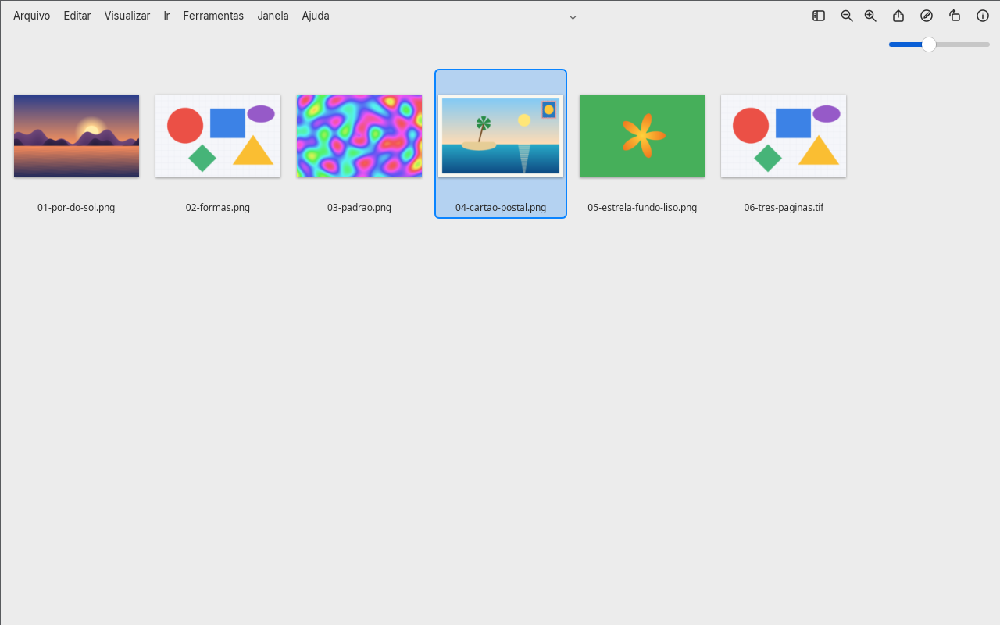
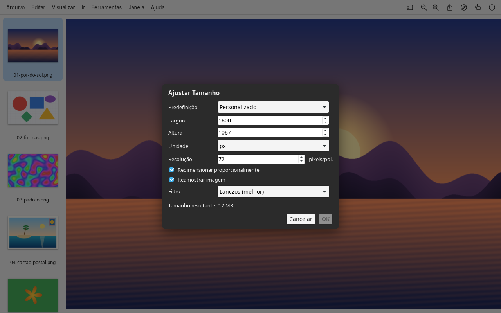
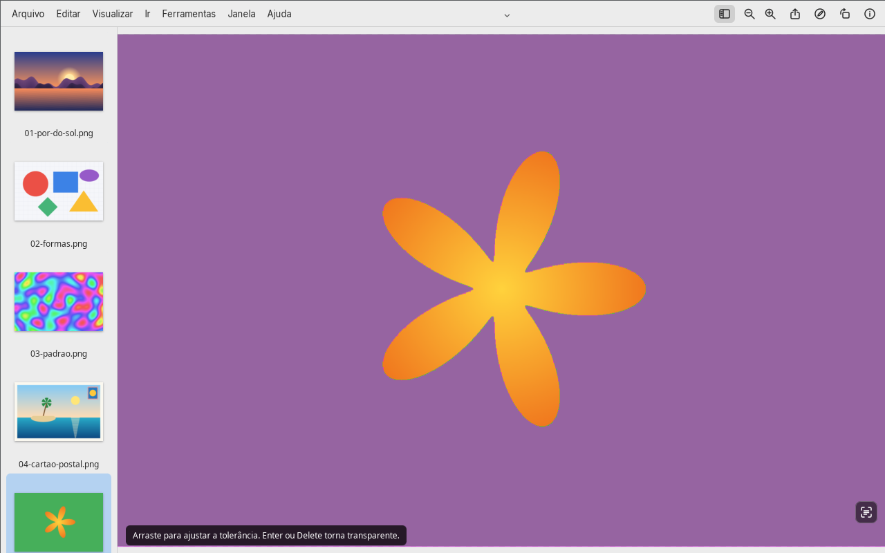
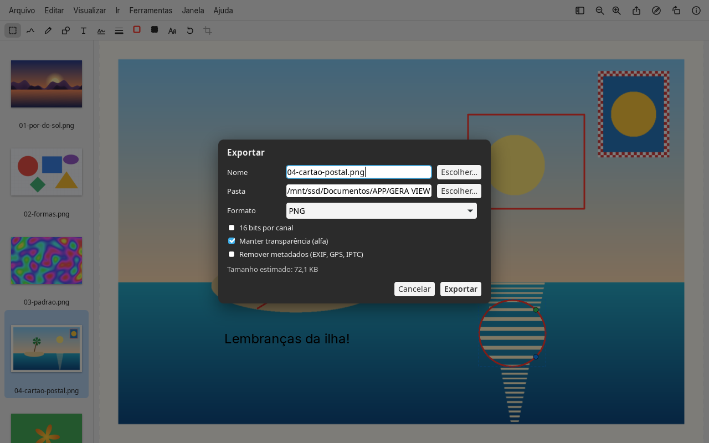

<p align="center">
  
</p>

<h1 align="center">Gera View Image</h1>

<p align="center">
  <a href="https://github.com/junior9283/gera-view-image/releases/latest"></a>
  <a href="https://github.com/junior9283/gera-view-image/actions/workflows/ci.yml"></a>
  <a href="LICENSE"></a>
</p>

Visualizador e editor de imagens para Linux, inspirado no Pré-Visualização do macOS. Abre quase qualquer
formato de imagem, navega pela pasta, gira, recorta, ajusta cor e tamanho, anota (setas, formas, texto,
lupa, assinatura) e exporta, tudo numa janela leve que segue o tema do sistema. Feito em Tauri 2 + Rust
(decodificação e edição) e React (interface), em português e inglês.

<p align="center"></p>

> Versão 0.x: a paridade com o Pré-Visualização ainda não está completa. Veja "Limitações conhecidas" no
> [CHANGELOG](CHANGELOG.md).

## Funções

### Abrir e navegar
Abra um ou vários arquivos (Ctrl+O, arrastar e soltar, linha de comando ou "Abrir com" do gerenciador de
arquivos). Com um só arquivo aberto, ← e → percorrem as imagens da mesma pasta. A barra lateral mostra
miniaturas, folha de contatos (grade) ou fica oculta. TIFF com várias páginas e GIF animado aparecem como
páginas. Arquivo corrompido mostra o erro só nele; os demais continuam navegáveis.

| Tema claro | Tema escuro |
|---|---|
|  |  |



### Visualizar
Tamanho Real (Ctrl+0), Ajustar à Janela (Ctrl+9), zoom com Ctrl+roda e pinça do touchpad, arrastar para
mover, Tela Cheia (F11) e Apresentação (Ctrl+Shift+F). O fundo da área de imagem é configurável, com xadrez
para transparência. Imagens enormes abrem por uma prévia reduzida e são detalhadas sob demanda.

### Marcação
A barra de Marcação (Ctrl+Shift+M) tem esboço com reconhecimento de forma, desenho livre, linha, seta,
retângulo, oval, balão de fala, estrela, polígono, **Lupa**, **Realce**, texto com estilo e **Assinatura**
(desenhada ou importada, salva para reutilizar). As anotações continuam editáveis até Salvar ou Exportar,
quando são achatadas na imagem.


### Ajustar Cor e Ajustar Tamanho
Ajustar Cor (Ctrl+Alt+C): histograma com níveis, Ajuste Automático, exposição, contraste, realces, sombras,
saturação, temperatura, matiz, sépia e nitidez, com prévia ao vivo. Ajustar Tamanho: px, %, cm, mm ou pol,
resolução (ppp), proporção travada, reamostragem e tamanho resultante em tempo real.

| Ajustar Cor | Ajustar Tamanho |
|---|---|
|  |  |

### Seleção e Alfa Instantâneo
Seleção retangular, elíptica, laço e laço inteligente; copiar, recortar, apagar e inverter a seleção.
O **Alfa Instantâneo** torna uma cor transparente: arraste sobre ela, e a distância do arrasto controla a
tolerância.



### Inspetor
Inspetor (Ctrl+I) com dimensões, resolução, perfil de cor, datas, EXIF, IPTC, GPS (com link para o mapa),
palavras-chave editáveis e a lista de anotações.


### Arquivo
Salvar (Ctrl+S) grava de forma atômica, preserva EXIF/IPTC/ICC e zera a orientação depois de girar.
Exportar oferece JPEG, PNG, TIFF, HEIC, WebP, AVIF, JPEG 2000, OpenEXR, BMP e PDF (com Alt, também GIF, ICO,
TGA e PSD), com qualidade, resolução, profundidade, alfa, etiquetas e **tamanho estimado**. Também há Exportar Selecionadas (lote), Duplicar, Renomear, Mover Para, Reverter, Imprimir,
Capturar Tela (via portal, funciona no Wayland) e Novo da Área de Transferência. Nada é gravado sem Salvar;
ao fechar com alterações, o app pergunta. Se o arquivo mudar ou for apagado fora do app, aparece um aviso
com a opção de recarregar.



## Atalhos de teclado

Os atalhos seguem os do Pré-Visualização com Cmd trocado por Ctrl. Diferenças: **Mostrar Barra de Marcação
é Ctrl+Shift+M** (no macOS é Cmd+Shift+A, mas Ctrl+Shift+A conflita com convenções do Linux), **Ocultar
Barra de Ferramentas é Ctrl+Shift+T** (Ctrl+Alt+T abre o terminal no GNOME e no KDE) e **Tela Cheia é F11**.
Itens de funções ainda em desenvolvimento aparecem desabilitados nos menus, e o atalho deles não faz nada. **Alt** (ou F10) abre a barra de menus. A tabela abaixo é gerada de `src/shortcuts/keymap.ts`.

<!-- atalhos:inicio (gerado por scripts/shortcuts-table.mjs) -->
| Menu | Comando | Atalho |
|---|---|---|
| Arquivo | Novo da Área de Transferência | `Ctrl+N` |
| Arquivo | Abrir | `Ctrl+O` |
| Arquivo | Fechar | `Ctrl+W` |
| Arquivo | Salvar | `Ctrl+S` |
| Arquivo | Duplicar | `Ctrl+Shift+S` |
| Arquivo | Imprimir | `Ctrl+P` |
| Arquivo | Sair | `Ctrl+Q` |
| Arquivo | Fechar Todas | `Ctrl+Alt+W` |
| Arquivo | Fechar Janela | `Ctrl+Shift+W` |
| Arquivo | Salvar Como | `Ctrl+Shift+Alt+S` |
| Arquivo | Mover para o Lixo | `Ctrl+Backspace` |
| Editar | Desfazer | `Ctrl+Z` |
| Editar | Refazer | `Ctrl+Shift+Z` |
| Editar | Recortar | `Ctrl+X` |
| Editar | Copiar | `Ctrl+C` |
| Editar | Colar | `Ctrl+V` |
| Editar | Apagar | `Del` ou `Backspace` |
| Editar | Selecionar Tudo | `Ctrl+A` |
| Editar | Desmarcar Tudo | `Esc` |
| Editar | Inverter Seleção | `Ctrl+Shift+I` |
| Editar | Preferências | `Ctrl+,` |
| Editar | Localizar | `Ctrl+F` |
| Editar | Localizar Próxima | `Ctrl+G` |
| Editar | Localizar Anterior | `Ctrl+Shift+G` |
| Visualizar | Ocultar Barra Lateral | `Ctrl+Alt+1` |
| Visualizar | Miniaturas | `Ctrl+Alt+2` |
| Visualizar | Folha de Contatos | `Ctrl+Alt+3` |
| Visualizar | Tamanho Real | `Ctrl+0` |
| Visualizar | Ajustar à Janela | `Ctrl+9` |
| Visualizar | Ampliar | `Ctrl+=` ou `Ctrl++` |
| Visualizar | Reduzir | `Ctrl+-` |
| Visualizar | Ampliar Seleção | `Ctrl+*` |
| Visualizar | Mostrar Barra de Marcação | `Ctrl+Shift+M` |
| Visualizar | Apresentação | `Ctrl+Shift+F` |
| Visualizar | Entrar em Tela Cheia | `F11` ou `Ctrl+Meta+F` |
| Visualizar | Ocultar Barra de Ferramentas | `Ctrl+Shift+T` |
| Visualizar | Mostrar Todas as Abas | `Ctrl+\|` |
| Ir | Anterior | `←` ou `PageUp` ou `↑` |
| Ir | Próximo | `→` ou `PageDown` ou `↓` |
| Ir | Primeiro | `Home` |
| Ir | Último | `End` |
| Ir | Voltar | `Ctrl+[` |
| Ir | Avançar | `Ctrl+]` |
| Ferramentas | Girar à Esquerda | `Ctrl+L` |
| Ferramentas | Girar à Direita | `Ctrl+R` |
| Ferramentas | Recortar | `Ctrl+K` |
| Ferramentas | Ajustar Cor | `Ctrl+Alt+C` |
| Ferramentas | Mostrar Inspetor | `Ctrl+I` |
| Ferramentas | Remover Fundo | `Ctrl+Shift+K` |
| Ferramentas | Mostrar Lupa | `` ` `` |
| Ferramentas | Mostrar Cores | `Ctrl+Shift+C` |
| Ferramentas | Mostrar Fontes | `Ctrl+T` |
| Janela | Minimizar | `Ctrl+M` |
| Janela | Mostrar Aba Anterior | `Ctrl+Shift+Tab` |
| Janela | Mostrar Próxima Aba | `Ctrl+Tab` |
| Ajuda | Pesquisar | `Ctrl+?` |
<!-- atalhos:fim -->

## Formatos

| | Formatos |
|---|---|
| **Abrir** | JPEG, PNG, GIF (animado), BMP, TIFF (várias páginas), WebP, HEIC/HEIF, AVIF, JPEG 2000, ICO, SVG, PSD (achatado), TGA e RAW (DNG, CR2/CR3, NEF, ARW, ORF, RW2) como prévia revelada |
| **Salvar no próprio arquivo** | JPEG, PNG, TIFF, HEIC, WebP, AVIF, JPEG 2000 e BMP |
| **Exportar** | JPEG, PNG, TIFF, HEIC, WebP, AVIF, JPEG 2000, OpenEXR e BMP |

**Abrir HEIC precisa da `libde265`**: no Fedora ela vem do [RPM Fusion](https://rpmfusion.org/)
(`sudo dnf install libde265`); no Ubuntu/Debian, do pacote `libde265-0`. Sem ela o app abre normalmente e
avisa ao tentar abrir um HEIC. **Gravar HEIC precisa da `libkvazaar`** (`libkvazaar7` no Debian 13+/Ubuntu 26.04+;
`kvazaar-libs` no Fedora, pelo RPM Fusion); sem ela o HEIC some do Exportar e o Salvar de um HEIC leva ao Exportar.
Os pacotes .deb/.rpm recomendam as duas bibliotecas.

## Instalação

Baixe o pacote do [último release](https://github.com/junior9283/gera-view-image/releases/latest):

- **Fedora:** `sudo dnf install ./Gera.View.Image-X.Y.Z-1.x86_64.rpm`
- **Ubuntu/Debian:** `sudo apt install ./Gera.View.Image_X.Y.Z_amd64.deb`
- **AppImage (qualquer distribuição):** `chmod +x Gera.View.Image_X.Y.Z_amd64.AppImage` e execute o arquivo.

Só Linux x86_64.

## Atualização automática

Ao iniciar (no máximo uma vez por dia) e em Ajuda ▸ Verificar Atualizações…, o app lê o `latest.json` do
último release deste repositório. As atualizações são assinadas e a assinatura é conferida antes de instalar.
O diálogo mostra as novidades e oferece **Instalar e Reiniciar**, **Depois** e **Pular esta versão**. O
AppImage substitui o próprio arquivo; `.deb` e `.rpm` são instalados com `pkexec`, que pede a senha na janela
do sistema. A verificação automática pode ser desligada nas Preferências.


## Como compilar

Requisitos: Rust estável, Node 22, `cmake`, WebKitGTK 4.1 e `libaom` com headers.

```bash
# Fedora
sudo dnf install webkit2gtk4.1-devel cmake libaom-devel librsvg2-devel libappindicator-gtk3-devel
# Ubuntu/Debian
sudo apt install libwebkit2gtk-4.1-dev cmake libaom-dev librsvg2-dev libayatana-appindicator3-dev patchelf

npm ci
npm run tauri build            # pacotes em src-tauri/target/release/bundle
```

Se a pasta do projeto tiver espaço no caminho, defina `CARGO_TARGET_DIR` para uma pasta sem espaço (veja
[docs/testes/armadilhas.md](docs/testes/armadilhas.md)). Testes: `npm run lint`, `npm run typecheck`,
`npm test`, `npm run test:rust` e o E2E descrito em [docs/testes/guia.md](docs/testes/guia.md).

## Como lançar uma versão

```bash
npm run release 0.3.0          # sincroniza versões, fecha o CHANGELOG, faz commit e tag anotada
git push --follow-tags         # o GitHub Actions gera .deb, .rpm, AppImage e latest.json
```

## Licença

[MIT](LICENSE). Não usa nenhum recurso da Apple; "Pré-Visualização" é citado só como referência de
comportamento.
