<p align="center">
  
</p>

<h1 align="center">Gera View Image</h1>

<p align="center">
  <a href="https://github.com/junior9283/gera-view-image/releases/latest"></a>
  <a href="https://github.com/junior9283/gera-view-image/actions/workflows/ci.yml"></a>
  <a href="LICENSE"></a>
</p>

Visualizador e editor de imagens para Linux, inspirado no Pré-Visualização (Preview) do macOS. Abre quase
qualquer formato de imagem em abas ou janelas, mostra miniaturas e folha de contatos, gira, recorta, seleciona,
ajusta cor e tamanho, anota (setas, formas, texto, lupa, assinatura), lê e edita metadados, faz prova de cor,
importa do scanner e exporta em vários formatos. Tudo numa janela leve que segue o tema claro ou escuro do
sistema, em português e inglês, sem telemetria. Feito em Tauri 2 + Rust (decodificação, cor e edição) e React
(interface).

<p align="center"></p>

**[Baixar a última versão](https://github.com/junior9283/gera-view-image/releases/latest)** (.deb, .rpm e
AppImage, Linux x86_64) · [Novidades](CHANGELOG.md) · [Instalação](#instalação) · [Atalhos](#atalhos-de-teclado)

## Funções

### Abrir, navegar e organizar
Abra um ou vários arquivos (Ctrl+O, arrastar e soltar, linha de comando ou "Abrir com" do gerenciador de
arquivos). Com um só arquivo aberto, ← e → percorrem as imagens da mesma pasta, e Ir › Voltar/Avançar
(Ctrl+[ / Ctrl+]) andam pelo histórico. O app tem uma instância só: abrir mais imagens pelo gerenciador de
arquivos as entrega à janela usada por último, e um arquivo que já está aberto traz a janela dele para a frente.

A barra lateral mostra **miniaturas** (Ctrl+Alt+2), a **Folha de Contatos** em grade (Ctrl+Alt+3) ou fica
oculta (Ctrl+Alt+1). Nas duas, Ctrl+clique, Shift+clique e Ctrl+A selecionam várias imagens; arrastar
reordena; Visualizar › Ordenar Por organiza por nome, data, tipo ou tamanho; e girar, espelhar, ajustar cor,
ajustar tamanho, exportar, imprimir e mover para o Lixo valem para todas as selecionadas. O botão direito numa
miniatura abre o menu com essas ações.

| Tema claro | Tema escuro |
|---|---|
| 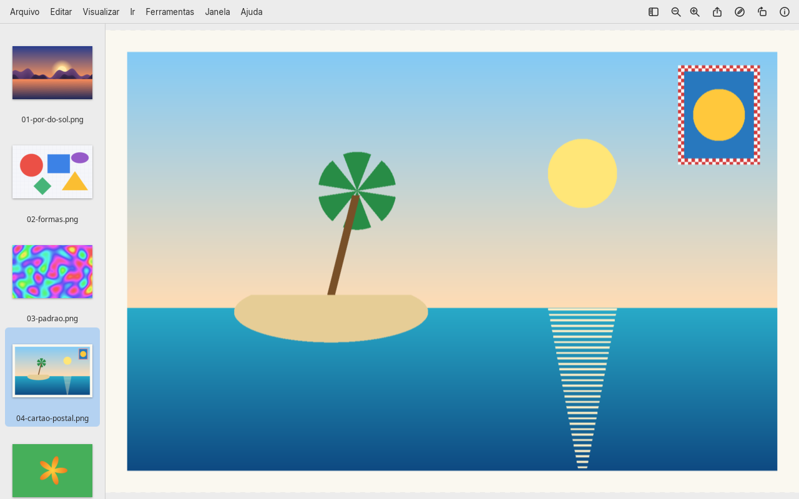 | 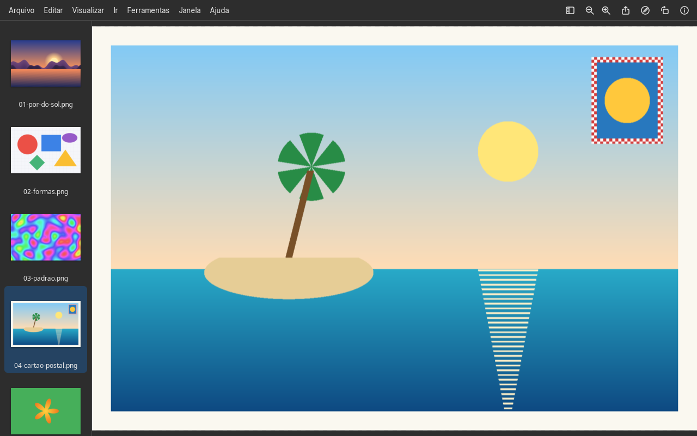 |


### Várias janelas e abas
Em Preferências › Abrir arquivos você escolhe abrir as imagens **em abas**, **na mesma janela** (barra lateral)
ou **em janelas separadas**. Visualizar › Mostrar Barra de Abas mostra uma aba por imagem (ponto nas não
salvas, botão do meio fecha), e Mostrar Todas as Abas (Ctrl+Shift+\\) mostra as miniaturas de todas. No menu
Janela: Mostrar Aba Anterior/Próxima (Ctrl+Shift+Tab / Ctrl+Tab), Mover Aba para Nova Janela, Juntar Todas as
Janelas, Trazer Tudo para a Frente e a lista das janelas abertas. Ao mudar de janela, a imagem leva o desfazer,
as anotações, a seleção e a página.

| Barra de abas | Mostrar Todas as Abas |
|---|---|
| 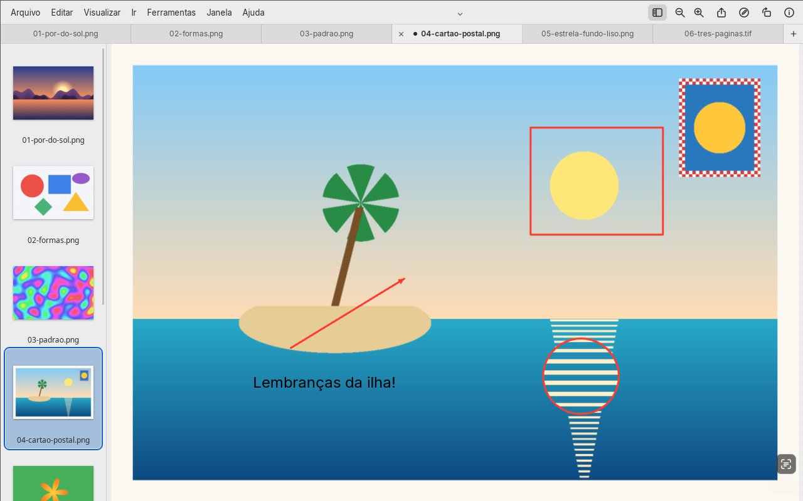 | 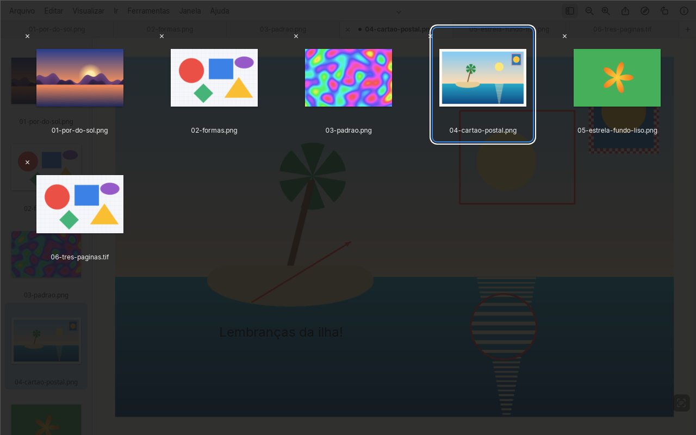 |

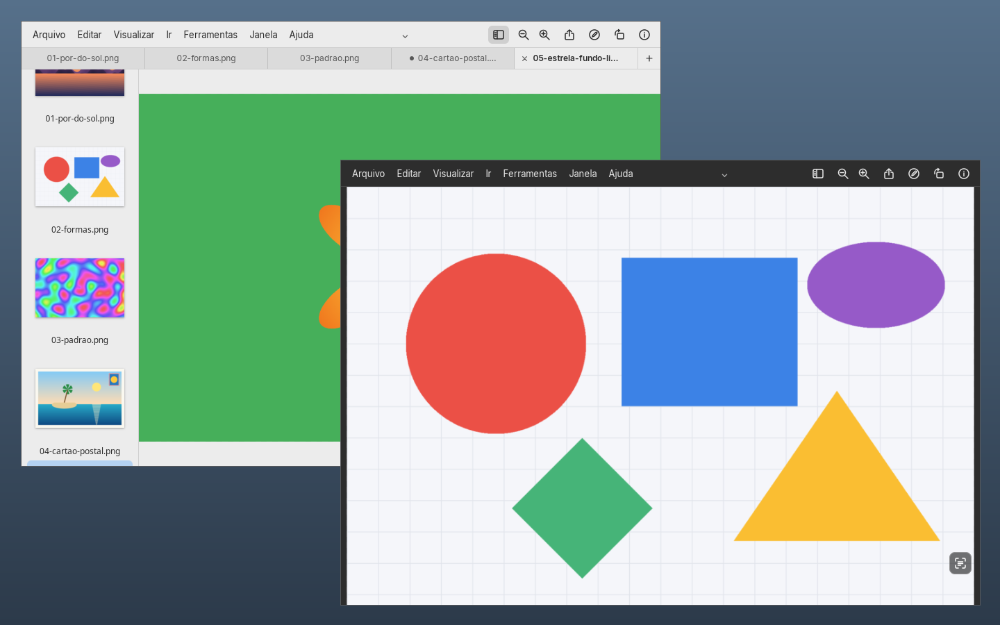

### Visualizar
Tamanho Real (Ctrl+0), Ajustar à Janela (Ctrl+9), zoom com Ctrl+roda e pinça do touchpad, Espaço+arrastar ou
botão do meio para mover, Tela Cheia (F11) e Apresentação (Ctrl+Shift+F). Ferramentas › Mostrar Lupa (tecla
`` ` ``) abre uma lente que amplia 3× a imagem sob o ponteiro. O fundo atrás da transparência é configurável
(com xadrez), e "100% corresponde a" um pixel da tela ou ao tamanho impresso. Imagens enormes abrem por uma
prévia reduzida e são detalhadas sob demanda.

### Marcação
A barra de Marcação (Ctrl+Shift+M) tem esboço com reconhecimento de forma, desenho livre, linha, seta,
retângulo, oval, balão de fala, estrela, polígono, **Lupa**, **Realce**, texto com estilo e **Assinatura**
(desenhada, importada de uma imagem ou capturada pela câmera, salva para reutilizar). Duplo
clique numa forma ou balão escreve dentro dele. Os painéis **Cores** (Ctrl+Shift+C, com conta-gotas) e
**Fontes** (Ctrl+T) e o Inspetor de Marcação ajustam borda, preenchimento, espessura, tracejado, sombra e
opacidade. Anotações se copiam, colam e duplicam (Ctrl+D), inclusive entre imagens e janelas, e continuam
editáveis até Salvar ou Exportar, quando são achatadas na imagem.

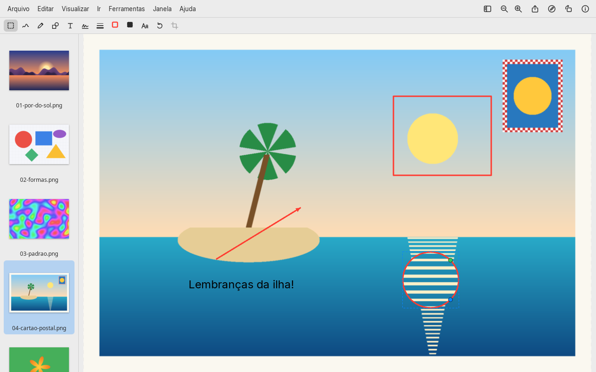

### Seleção, Alfa Instantâneo e Remover Fundo
Ferramentas › Seleção Retangular, Elíptica, Laço e **Laço Inteligente** (o contorno gruda na borda do objeto
ao soltar); arrastar na imagem já seleciona um retângulo, mostrando o tamanho em px. Shift soma e Alt subtrai;
arrastar dentro da seleção ou as setas a movem. Depois é só copiar, recortar a imagem na seleção (Ctrl+K),
apagar ou inverter a seleção (Ctrl+Shift+I). O **Alfa Instantâneo** torna uma cor transparente: arraste sobre ela, e a distância do arrasto
controla a tolerância. **Remover Fundo** (Ctrl+Shift+K) e **Copiar Objeto** usam um modelo de IA que roda no
próprio computador.

| Laço Inteligente | Alfa Instantâneo |
|---|---|
| 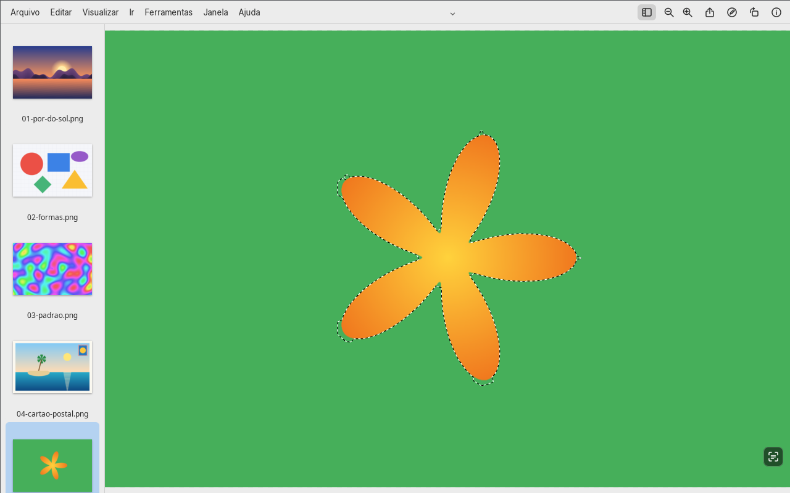 |  |

### Texto ao Vivo
O texto das imagens é reconhecido localmente (OCR em português, com acentos): selecione arrastando, copie com
Ctrl+C, procure com Ctrl+F, ou use Ferramentas › Texto ao Vivo › Copiar Todo o Texto. Links, e-mails,
telefones e QR codes detectados ficam clicáveis.

### Ajustar Cor e Ajustar Tamanho
**Ajustar Cor** (Ctrl+Alt+C) mostra o resultado **ao vivo na própria imagem**: histograma com níveis, Ajuste
Automático, exposição, contraste, realces, sombras, saturação, temperatura, matiz, sépia e nitidez. **Ajustar
Tamanho**: px, %, cm, mm ou pol, resolução (ppp), proporção travada, reamostragem e tamanho resultante em
tempo real. Os dois valem para todas as miniaturas selecionadas, cada imagem com o próprio desfazer.

| Ajustar Cor (prévia na imagem) | Ajustar Tamanho |
|---|---|
| 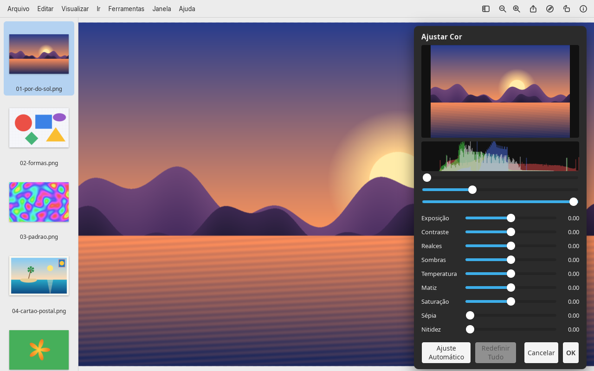 |  |

### Cor e Prova de Cor
Imagens com perfil ICC (Display P3, Adobe RGB, ProPhoto, Rec. 2020 e outros) e as que declaram o espaço de
cor sem perfil (nclx do HEIC/AVIF, `cICP`/`sRGB`/`gAMA`/`cHRM` do PNG) aparecem com as cores certas.
Ferramentas › Atribuir Perfil reinterpreta a imagem com outro perfil. **Visualizar › Prova de Cor com Perfil**
mostra como a imagem sairia em outro perfil (embutido, instalado no sistema, inclusive CMYK e cinza, ou um
arquivo .icc), só na tela e sem alterar o arquivo.

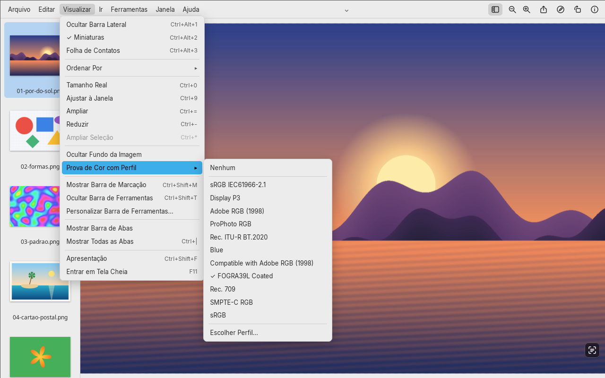

### Inspetor
O Inspetor (Ctrl+I) mostra dimensões, resolução, perfil de cor, datas, EXIF (câmera, exposição, lente e
fabricante), IPTC, abas próprias de cada formato, **GPS** (com link para o mapa) e a lista de anotações. Edita
título, descrição, autor, a Descrição da Imagem (texto alternativo) e as **palavras-chave**, gravados no XMP e
no IPTC ao salvar. A aba Recorte mostra e edita a posição e o tamanho da seleção.

| EXIF | GPS | Palavras-chave |
|---|---|---|
| 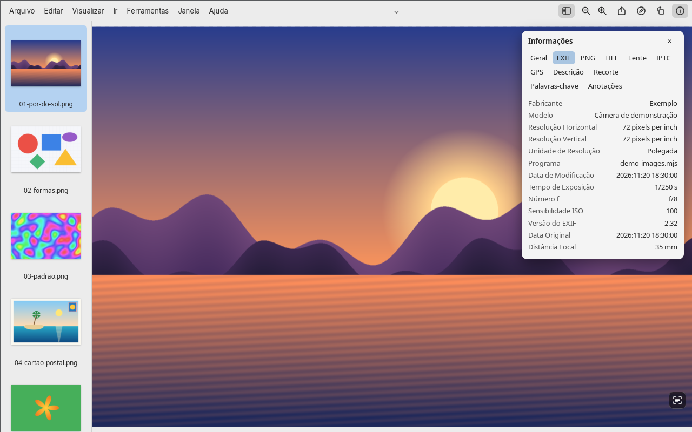 | 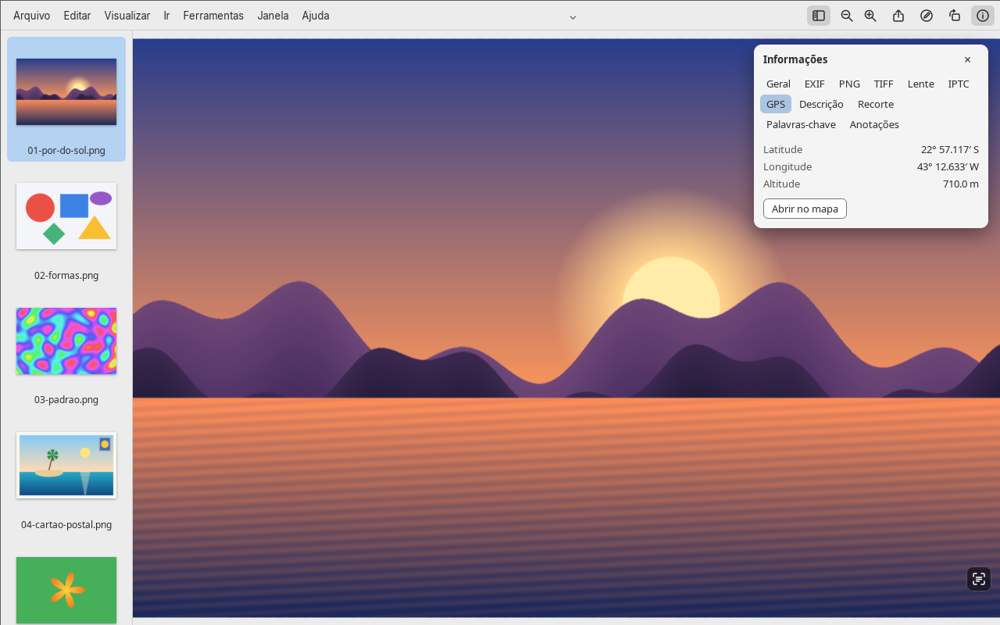 | 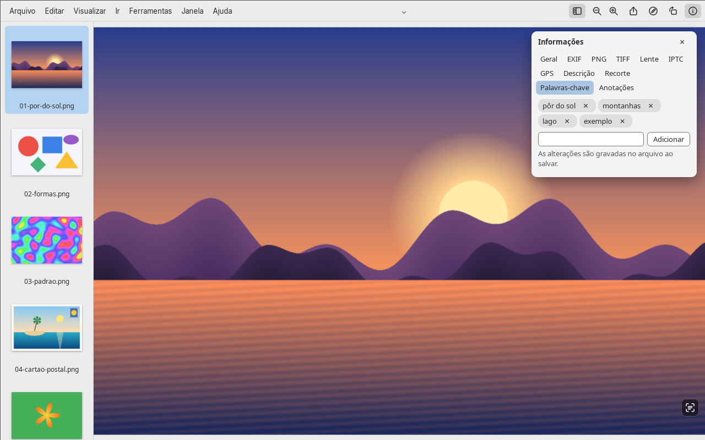 |

### TIFF de várias páginas
As páginas de um TIFF (e os quadros de um GIF animado) aparecem em sequência na barra lateral, cada uma no
próprio tamanho; → e Page Down vão à página seguinte. Recortar, girar, ajustar e anotar valem para a página
exibida, e Salvar grava o arquivo inteiro, com todas as páginas, anotações e metadados.

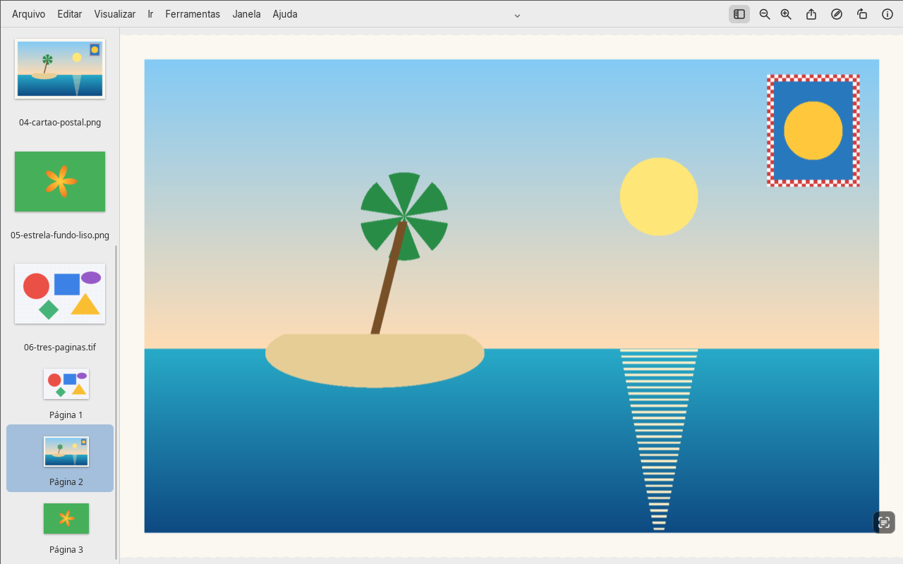

### Arquivo
- **Salvar** (Ctrl+S) grava de forma atômica, preserva EXIF/IPTC/XMP/ICC e zera a orientação depois de girar;
  antes, a versão anterior é guardada (Reverter Para › Procurar Todas as Versões…). **Salvar Como** grava em
  outro formato. Antes de gravar, o app avisa o que o formato escolhido não guarda (páginas, EXIF, XMP).
- **Exportar** oferece JPEG, PNG, TIFF, HEIC, WebP, AVIF, JPEG 2000, OpenEXR, BMP e PDF (com Alt, também GIF,
  ICO, TGA e PSD), com qualidade, resolução (ppp), profundidade, alfa, compressão do TIFF, perfil de cor,
  etiquetas e **tamanho estimado**. Também há Exportar Selecionadas (lote) e **Exportar como PDF…** (uma página
  por imagem).
- **Importar do Scanner…**: escolha o scanner, o modo (cor, tons de cinza ou preto e branco) e a resolução; a
  digitalização vira uma imagem nova. Usa o `scanimage` do SANE (pacote `sane-utils` ou `sane-backends`).
- **Imprimir** (Ctrl+P) com prévia, cópias, papel, orientação, escala e várias imagens por página, pelo diálogo
  de impressão do sistema.
- Duplicar, Renomear, Mover Para, Etiquetas, Bloquear, Mover para o Lixo, Compartilhar (e-mail e KDE Connect),
  Capturar Tela (via portal, funciona no Wayland) e Novo da Área de Transferência.

Nada é gravado sem Salvar; ao fechar com alterações, o app pergunta. Se o arquivo mudar ou for apagado fora do
app, aparece um aviso com a opção de recarregar.


## Atalhos de teclado

Os atalhos seguem os do Pré-Visualização com Cmd trocado por Ctrl. Diferenças: **Mostrar Barra de Marcação
é Ctrl+Shift+M** (no macOS é Cmd+Shift+A, mas Ctrl+Shift+A conflita com convenções do Linux), **Ocultar
Barra de Ferramentas é Ctrl+Shift+T** (Ctrl+Alt+T abre o terminal no GNOME e no KDE) e **Tela Cheia é F11**.
**Alt+arrastar** (duplicar anotação, subtrair da seleção) pode não chegar ao app: em alguns ambientes (Xfce,
MATE, Cinnamon, KDE Plasma 5 ou GNOME com a tecla de ação de janela trocada para Alt) o gerenciador de janelas usa
Alt+arrastar para mover a janela. Troque essa tecla para Super nas configurações do sistema (GNOME: Ajustes ›
Janelas › Tecla de ação da janela; KDE: Configurações do Sistema › Gerenciamento de janelas › Ações das janelas).
**Alt** (ou F10) abre a barra de menus, e Ajuda › Pesquisar (Ctrl+?) acha qualquer comando pelo nome. A tabela
abaixo é gerada de `src/shortcuts/keymap.ts`.

<!-- atalhos:inicio (gerado por scripts/shortcuts-table.mjs) -->
| Menu | Comando | Atalho |
|---|---|---|
| Arquivo | Novo da Área de Transferência | `Ctrl+N` |
| Arquivo | Abrir | `Ctrl+O` |
| Arquivo | Fechar | `Ctrl+W` |
| Arquivo | Salvar | `Ctrl+S` |
| Arquivo | Duplicar | `Ctrl+Shift+S` |
| Arquivo | Imprimir | `Ctrl+P` |
| Arquivo | Sair | `Ctrl+Q` |
| Arquivo | Fechar Todas | `Ctrl+Alt+W` |
| Arquivo | Fechar Janela | `Ctrl+Shift+W` |
| Arquivo | Salvar Como | `Ctrl+Shift+Alt+S` |
| Arquivo | Mover para o Lixo | `Ctrl+Backspace` ou `Ctrl+Del` |
| Editar | Desfazer | `Ctrl+Z` |
| Editar | Refazer | `Ctrl+Shift+Z` |
| Editar | Recortar | `Ctrl+X` |
| Editar | Copiar | `Ctrl+C` |
| Editar | Colar | `Ctrl+V` |
| Editar | Duplicar Anotação | `Ctrl+D` |
| Editar | Apagar | `Del` ou `Backspace` |
| Editar | Selecionar Tudo | `Ctrl+A` |
| Editar | Desmarcar Tudo | `Esc` |
| Editar | Inverter Seleção | `Ctrl+Shift+I` |
| Editar | Preferências | `Ctrl+,` |
| Editar | Localizar | `Ctrl+F` |
| Editar | Localizar Próxima | `Ctrl+G` |
| Editar | Localizar Anterior | `Ctrl+Shift+G` |
| Visualizar | Ocultar Barra Lateral | `Ctrl+Alt+1` |
| Visualizar | Miniaturas | `Ctrl+Alt+2` |
| Visualizar | Folha de Contatos | `Ctrl+Alt+3` |
| Visualizar | Tamanho Real | `Ctrl+0` |
| Visualizar | Ajustar à Janela | `Ctrl+9` |
| Visualizar | Ampliar | `Ctrl+=` ou `Ctrl++` |
| Visualizar | Reduzir | `Ctrl+-` |
| Visualizar | Ampliar Seleção | `Ctrl+*` |
| Visualizar | Mostrar Barra de Marcação | `Ctrl+Shift+M` |
| Visualizar | Apresentação | `Ctrl+Shift+F` |
| Visualizar | Entrar em Tela Cheia | `F11` ou `Ctrl+Meta+F` |
| Visualizar | Ocultar Barra de Ferramentas | `Ctrl+Shift+T` |
| Visualizar | Mostrar Todas as Abas | `Ctrl+\|` |
| Ir | Anterior | `←` ou `PageUp` ou `↑` |
| Ir | Próximo | `→` ou `PageDown` ou `↓` |
| Ir | Primeiro | `Home` |
| Ir | Último | `End` |
| Ir | Voltar | `Ctrl+[` |
| Ir | Avançar | `Ctrl+]` |
| Ferramentas | Girar à Esquerda | `Ctrl+L` |
| Ferramentas | Girar à Direita | `Ctrl+R` |
| Ferramentas | Recortar | `Ctrl+K` |
| Ferramentas | Ajustar Cor | `Ctrl+Alt+C` |
| Ferramentas | Mostrar Inspetor | `Ctrl+I` |
| Ferramentas | Remover Fundo | `Ctrl+Shift+K` |
| Ferramentas | Mostrar Lupa | `` ` `` |
| Ferramentas | Mostrar Cores | `Ctrl+Shift+C` |
| Ferramentas | Mostrar Fontes | `Ctrl+T` |
| Janela | Minimizar | `Ctrl+M` |
| Janela | Mostrar Aba Anterior | `Ctrl+Shift+Tab` |
| Janela | Mostrar Próxima Aba | `Ctrl+Tab` |
| Ajuda | Pesquisar | `Ctrl+?` |
<!-- atalhos:fim -->

## Formatos

| | Formatos |
|---|---|
| **Abrir** | JPEG, PNG, GIF (animado), BMP, TIFF (várias páginas), WebP, HEIC/HEIF, AVIF, JPEG 2000 (inclusive .j2k/.jpx), JPEG XL (primeiro quadro), OpenEXR, Radiance HDR, PNM (PBM, PGM, PPM, PAM), ICO, ICNS (maior ícone), SVG, PSD (achatado), TGA, DDS, Farbfeld e RAW (DNG, CR2/CR3, NEF, ARW, ORF, RW2) como prévia revelada |
| **Salvar no próprio arquivo** | JPEG, PNG, TIFF, HEIC, WebP, AVIF, JPEG 2000 e BMP |
| **Salvar Como** | os de cima e OpenEXR |
| **Exportar** | JPEG, PNG, TIFF, HEIC, WebP, AVIF, JPEG 2000, OpenEXR, BMP e PDF (com Alt: GIF, ICO, TGA e PSD) |

O formato é reconhecido pelo conteúdo, não pela extensão. OpenEXR, Radiance e imagens PQ/HLG são mostrados em
SDR: até 75 % do branco nada muda; acima, o brilho é comprimido até o ponto mais claro da imagem, sem girar o
matiz (não há HDR na tela). QOI não abre (exigiria outra dependência).

## Requisitos

- Linux x86_64 com WebKitGTK 4.1. Os pacotes são testados a cada versão no Ubuntu 22.04 e 24.04 e no Fedora.
- Opcionais (os pacotes .deb e .rpm já recomendam):
  - **Abrir HEIC:** `libde265` (no Fedora, pelo [RPM Fusion](https://rpmfusion.org/); no Ubuntu/Debian,
    `libde265-0`). Sem ela o app abre normalmente e avisa ao tentar abrir um HEIC.
  - **Gravar HEIC:** `libkvazaar` (`libkvazaar7` no Debian 13+/Ubuntu 26.04+; `kvazaar-libs` no Fedora, pelo
    RPM Fusion). Sem ela o HEIC some do Exportar e o Salvar de um HEIC leva ao Exportar.
  - **Importar do Scanner:** `scanimage` do SANE (`sane-utils` no Debian/Ubuntu, `sane-backends` no Fedora).
    Sem ele o item fica desabilitado, com a explicação.
  - **Compartilhar › KDE Connect:** `kdeconnect-cli`.

## Instalação

Baixe o pacote da [página de Releases](https://github.com/junior9283/gera-view-image/releases/latest):

- **Fedora:** `sudo dnf install ./Gera.View.Image-X.Y.Z-1.x86_64.rpm`
- **Ubuntu/Debian:** `sudo apt install ./Gera.View.Image_X.Y.Z_amd64.deb`
- **AppImage (qualquer distribuição):** `chmod +x Gera.View.Image_X.Y.Z_amd64.AppImage` e execute o arquivo.

Troque `X.Y.Z` pela versão baixada. Todas as versões anteriores ficam em
[Releases](https://github.com/junior9283/gera-view-image/releases).

## Atualização automática

Ao iniciar (no máximo uma vez por dia) e em Ajuda › Verificar Atualizações…, o app lê o `latest.json` do
último release deste repositório. As atualizações são assinadas e a assinatura é conferida antes de instalar.
O diálogo mostra as novidades e oferece **Instalar e Reiniciar**, **Depois** e **Pular esta versão**; antes de
reiniciar, o app pergunta pelas alterações não salvas de todas as janelas. O AppImage substitui o próprio
arquivo; `.deb` e `.rpm` são instalados com `pkexec`, que pede a senha na janela do sistema. A verificação
automática pode ser desligada nas Preferências.

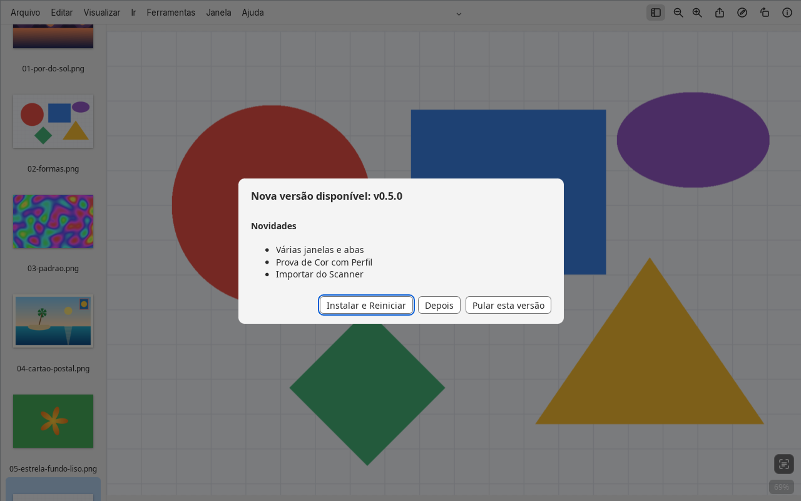

## Privacidade

- **Sem telemetria**, sem conta e sem anúncios. Nenhuma imagem sai do computador: OCR (Texto ao Vivo) e Remover
  Fundo rodam localmente.
- O app só acessa a rede para: verificar atualizações (o `latest.json` deste repositório; dá para desligar) e,
  no primeiro uso do Remover Fundo e só depois de você permitir, baixar o modelo de IA (4,4 MB) do GitHub,
  aceito apenas com o SHA-256 esperado.
- Abrir o mapa do GPS e Pesquisar/Traduzir do Texto ao Vivo abrem o navegador só quando você clica.
- Não há lista de arquivos recentes. As versões anteriores do Salvar ficam numa pasta privada do app
  (`~/.local/share/gera-view-image/versions`, com limite de espaço configurável; 0 desliga).
- A câmera (assinatura) só liga depois de um clique e de uma confirmação, e desliga ao capturar.
- Ao gravar, a miniatura embutida no EXIF (que mostraria a foto antes dos recortes) não é levada, e editar
  palavras-chave, título ou descrição também apaga as cópias antigas desses textos no EXIF.

## Diferenças em relação ao Pré-Visualização

- Ctrl no lugar de Cmd, com as exceções descritas em [Atalhos de teclado](#atalhos-de-teclado).
- Não abre nem edita PDF: o PDF é só formato de saída (Exportar e Exportar como PDF…).
- HDR é sempre mostrado em SDR. Prova de Cor sem simulação do branco do papel nem da tinta preta.
- O GPS do Inspetor tem link para o mapa (OpenStreetMap) em vez de um mapa embutido.
- Integrações do sistema seguem o Linux: impressão pelo diálogo do GTK, captura de tela pelo portal, scanner
  pelo SANE, Compartilhar por e-mail e KDE Connect, etiquetas no atributo `user.xdg.tags` (as mesmas do
  Dolphin).
- As limitações conhecidas estão no fim de cada versão do [CHANGELOG](CHANGELOG.md).

## Como compilar

Requisitos: Rust estável, Node 22, `cmake`, WebKitGTK 4.1 e `libaom` com headers.

```bash
# Fedora
sudo dnf install webkit2gtk4.1-devel cmake libaom-devel librsvg2-devel libappindicator-gtk3-devel
# Ubuntu/Debian
sudo apt install libwebkit2gtk-4.1-dev cmake libaom-dev librsvg2-dev libayatana-appindicator3-dev patchelf

npm ci
npm run tauri build            # pacotes em src-tauri/target/release/bundle
```

Se a pasta do projeto tiver espaço no caminho, defina `CARGO_TARGET_DIR` para uma pasta sem espaço (veja
[docs/testes/armadilhas.md](docs/testes/armadilhas.md)). Testes: `npm run lint`, `npm run typecheck`,
`npm test`, `npm run test:rust` e o E2E descrito em [docs/testes/guia.md](docs/testes/guia.md). Os prints
desta página saem do app real com imagens sintéticas (`scripts/demo-images.mjs` e `scripts/screenshots.mjs`).

## Como lançar uma versão

```bash
npm run release 0.5.0          # sincroniza versões, fecha o CHANGELOG, faz commit e tag anotada
git push --follow-tags         # o GitHub Actions gera .deb, .rpm, AppImage e latest.json
```

## Licença

[MIT](LICENSE). Não usa nenhum recurso da Apple; "Pré-Visualização" é citado só como referência de
comportamento. As imagens de exemplo dos prints são geradas por código, sem fotos de terceiros.
